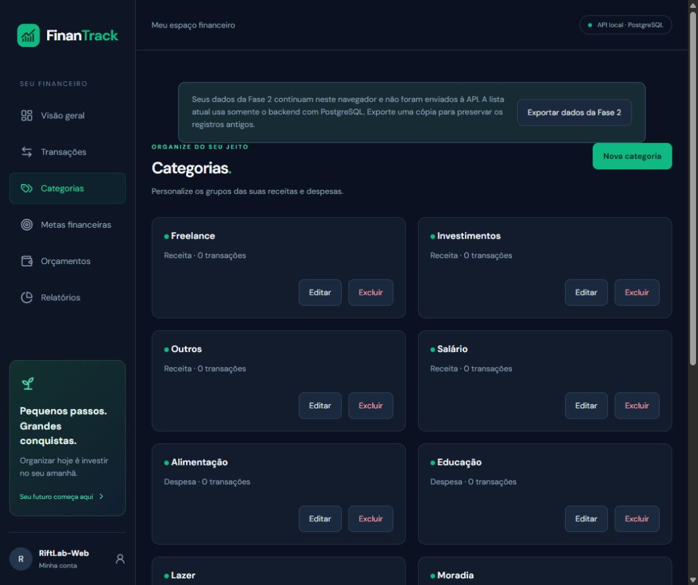

# FinanTrack

Aplicação de controle financeiro pessoal para portfólio full-stack: organize movimentações, acompanhe metas e limites e transforme seus registros em uma visão financeira clara.

A implementação local utiliza dados reais do PostgreSQL, isolados por conta autenticada. A preparação de publicação está em `docs/DEPLOYMENT.md`; nenhum deploy ou push foi realizado. Credenciais, domínios e validação do ambiente hospedado permanecem como passos externos.

## Funcionalidades

- Cadastro, login/logout e sessões persistidas com cookies HttpOnly; senhas bcrypt custo 12.
- Perfil com edição de nome e troca de senha, revogando todas as sessões.
- Dashboard mensal: saldo acumulado, receitas, despesas, resultado, taxa de economia e comparação com o mês anterior.
- Quatro gráficos: entradas/saídas, distribuição por categoria, evolução do saldo e evolução mensal de gastos. Estados vazios sem valores fictícios.
- Transações: criar, editar, excluir com confirmação, observações, pesquisa, filtros combinados por categoria/tipo/mês/intervalo, ordenação por data/valor e paginação de 15 linhas na interface.
- Categorias personalizadas com nome, cor e tipo, edição e exclusão quando não estão vinculadas a transações ou orçamentos.
- Metas: valor desejado, prazo opcional, contribuições registradas atomicamente, progresso, edição, conclusão e exclusão com confirmação.
- Orçamentos por categoria/mês/ano: limite único, gastos reais, percentual utilizado e alertas a partir de 80% e 100%.
- Relatórios por mês, ano e intervalo personalizado, resumo, comparação com intervalo anterior de mesma duração, maiores categorias e CSV seguro para planilhas.
- Impressão/Salvar PDF pelo navegador com CSS de impressão, sem bibliotecas extras. O fluxo de impressão depende do navegador; não gera PDF no servidor.
- Responsividade, carregamento, erros, feedback de sucesso, diálogos acessíveis e navegação por teclado.

## Tecnologias

React, TypeScript, Vite, React Router, Recharts, Lucide e CSS no frontend. Node.js, Express 5, Zod, Helmet, bcryptjs, cookie-parser e express-rate-limit na API. Prisma ORM 7.10.1, pg e PostgreSQL 18 para persistência. Vitest, Supertest, JSDOM, ESLint e Prettier para qualidade.

## Arquitetura e estrutura

```text
frontend/src/
  components/   Layout, cards, diálogos e gráficos reutilizáveis
  pages/        Dashboard, transações, categorias, metas, orçamentos,
                relatórios, autenticação e perfil
  hooks/        Sessão, transações compartilhadas e categorias
  services/     HTTP, CSRF em memória, exportação e backup legado
  types/        Contratos de apresentação
  utils/        Datas, BRL, filtros e cálculos em centavos
backend/
  src/routes/        HTTP e validação de entrada
  src/controllers/   Respostas das transações
  src/services/      Autenticação e regras financeiras
  src/repositories/  Persistência de transações via Prisma
  src/database/      Cliente Prisma
  src/schemas/       Validação Zod
  src/middlewares/   Erros padronizados
  prisma/            Modelos, seed e migrations versionadas
  tests/             HTTP, PostgreSQL real e CSV
  scripts/           Instância local e executor de testes do banco
```

Fluxo: página React → serviço HTTP com cookie/CSRF → validação e sessão Express → service → repository/Prisma → PostgreSQL. O servidor obtém o proprietário pela sessão, nunca pelo userId enviado no corpo.

O servidor real exige PostgreSQL e autenticação. O repository em memória é utilizado somente nos testes unitários HTTP; não é um fallback para falhas do banco. O frontend não mantém uma segunda fonte de verdade no localStorage.

## Pré-requisitos e instalação

Node.js 22.12+ ou 24 LTS, npm e PostgreSQL. No Windows, o helper usa a instalação em `C:\Program Files\PostgreSQL\18\bin` e mantém uma instância exclusiva do projeto na porta 55432.

```powershell
npm ci --prefix backend
npm ci --prefix frontend
npm run db:local:setup --prefix backend
npm run db:deploy --prefix backend
npm run dev --prefix backend
```

Em outro terminal:

```powershell
npm run dev --prefix frontend
```

Abra http://127.0.0.1:5173/register. Crie sua própria conta; não existe senha padrão. O cadastro cria somente categorias iniciais, sem transações fictícias.

Nas próximas execuções, use `npm run db:local:start --prefix backend` antes de iniciar a API. `db:local:stop` e `db:local:status` controlam somente a instância do projeto. O diretório `backend/.local-postgres/data` contém os registros persistidos: reiniciar os processos não os apaga.

Para uma instalação em outro caminho:

```powershell
cd backend
powershell -NoProfile -File scripts/database-local.ps1 -Action setup -PostgresBin 'D:\PostgreSQL\bin'
```

Em outro sistema operacional, use PostgreSQL instalado ou hospedado e configure as URLs diretamente em `.env`; o restante da aplicação é Node.js e não depende do helper Windows.

## Ambiente

O setup gera senhas aleatórias e conexões em `backend/.env`, sem sobrescrever variáveis existentes. Não copie o exemplo por cima das credenciais geradas. Arquivos `.env`, dados locais, dependências, cliente gerado e metadados de deploy estão ignorados pelo Git.

| Variável | Finalidade |
| --- | --- |
| DATABASE_URL | Banco da aplicação; conexão direta local ou pool do provedor. |
| DIRECT_DATABASE_URL | Opcional: conexão direta utilizada pelo Prisma Migrate quando há pool. |
| TEST_DATABASE_URL | Banco separado com nome contendo test; nunca o da aplicação. |
| SHADOW_DATABASE_URL | Banco descartável exclusivo do Prisma Migrate em desenvolvimento. |
| PORT / HOST | API: 3001 / 127.0.0.1 localmente; HOST=0.0.0.0 na hospedagem. |
| FRONTEND_ORIGINS | Origens exatas permitidas, separadas por vírgula; padrões locais localhost/127.0.0.1:5173. |
| NODE_ENV | development, test ou production. Produção ativa cookie Secure. |
| COOKIE_CROSS_SITE | false por padrão; true apenas em produção com SameSite=None/Secure. |
| TRUST_PROXY_HOPS | 0 localmente; 1 no proxy confiável do Render. |
| VITE_API_URL | /api por padrão, tanto no Vite quanto no proxy Vercel preparado. |
| API_PROXY_TARGET | Destino local do proxy Vite: http://127.0.0.1:3001. |

Apenas as duas últimas variáveis pertencem ao frontend. Nunca coloque segredos em variáveis VITE_. Configurações de produção e proxy estão detalhadas em `docs/DEPLOYMENT.md`.

## Modelo e regras de negócio

Users, sessions, categories, transactions, goals, contributions e budgets possuem chaves estrangeiras e índices. As três migrations são aditivas e preservam os registros anteriores.

- Valores no banco: Decimal(11,2), positivos para transações/contribuições/limites. Cálculos financeiros e percentuais de orçamento usam centavos inteiros.
- Datas financeiras: DATE, sem horário. Auditoria/sessões: TIMESTAMPTZ, retornados em UTC.
- Categoria: única por proprietário/nome/tipo. O tipo é imutável após criação, para preservar o histórico; nome/cor são editáveis. Exclusão vinculada responde 409, sem excluir transações ou orçamentos.
- Transações selecionam uma categoria existente da conta e do mesmo tipo. API mantém compatibilidade com category por nome/tipo e aceita categoryId; o frontend envia o ID.
- A contribuição incrementa a meta e grava o histórico na mesma transação do banco. Ao atingir o alvo, a meta é concluída. Metas concluídas recusam novas contribuições. Elas não criam receitas/despesas automaticamente, evitando dupla contabilização.
- Excluir uma meta exclui seu histórico de contribuições, após confirmação na interface. Excluir orçamento preserva as transações.
- Orçamento é único por proprietário, categoria, mês e ano. Somente despesas daquele período entram no cálculo.
- Relatórios comparam o intervalo selecionado com o intervalo imediatamente anterior de mesma duração; o dashboard compara meses de calendário. O gráfico de saldo usa o acumulado anterior ao intervalo e mostra meses com movimentação.
- CSV possui BOM UTF-8, separador ponto e vírgula, aspas escapadas e neutralização de fórmulas em campos de texto.

Prisma Decimal pode ser serializado como texto exato nas respostas de metas e gravação de orçamento; a interface converte explicitamente para apresentação. Transações, indicadores e listagem de orçamentos usam valores numéricos em reais no contrato existente.

### Dados anteriores

O armazenamento da Fase 2 permanece intacto na chave `finantrack.transactions.v1`. O aviso permite exportar uma cópia local, sem enviá-la automaticamente à API. A conta local antiga permanece sem login e não é associada automaticamente a contas novas. Uma importação/transferência desses registros exige uma ação explícita futura.

## API

Sucesso: `{data: ...}`; erros: `{error:{code,message,details?}}`; exclusões/logout retornam 204 sem corpo.

| Métodos | Endpoint | Uso |
| --- | --- | --- |
| GET | /api/health | Saúde pública e conexão ao banco. |
| POST | /api/auth/register, /api/auth/login | Cadastro/login com nova sessão. |
| GET | /api/auth/me | Conta e CSRF da sessão atual. |
| POST | /api/auth/logout, /api/auth/password | Logout/troca de senha. |
| PATCH | /api/auth/profile | Atualização de nome. |
| GET, POST | /api/transactions | Listar/criar. |
| GET, PUT, DELETE | /api/transactions/:id | Consultar/substituir/excluir. |
| GET, POST | /api/categories | Listar/criar. |
| PATCH, DELETE | /api/categories/:id | Editar/excluir. |
| GET, POST | /api/goals | Listar/criar. |
| PATCH, DELETE | /api/goals/:id | Editar/concluir/excluir. |
| POST | /api/goals/:id/contributions | Registrar contribuição. |
| GET, POST | /api/budgets | Listar por month/year e criar. |
| PATCH, DELETE | /api/budgets/:id | Editar/excluir. |
| GET | /api/reports, /api/dashboard | Indicadores por from/to. |
| GET | /api/reports/export | CSV por from/to, somente da conta. |

Toda escrita autenticada exige cookie, Origin autorizado e X-CSRF-Token. Login/cadastro exigem Origin autorizado. O cliente HTTP envia tudo automaticamente e remove a identidade ao receber 401.

Exemplo de entrada de transação, usando um ID real retornado por GET /api/categories:

```json
{"description":"Curso","amount":123.45,"type":"expense","category":"Educação","categoryId":"ID-REAL-DA-CATEGORIA","date":"2026-11-05","notes":"Observação opcional"}
```

Meta: `{"name":"Reserva","targetAmount":5000,"deadline":"2027-12-31"}`. Contribuição: `{"amount":150.50}`. Orçamento: `{"categoryId":"ID-REAL","amount":600,"month":11,"year":2026}`.

## Segurança

Hash bcrypt custo 12; limite de senha de 72 bytes para evitar truncamento do bcrypt. Sessões opacas de 256 bits, com apenas SHA-256 do identificador salvo no banco. Cookie HttpOnly, Secure em produção, SameSite apropriado e sem Domain. Sessões expiram em sete dias; logout revoga a atual e troca de senha revoga todas.

CSRF por sessão, validação de Origin, CORS restrito com credenciais, Helmet, entrada validada com Zod, ORM com parâmetros e erros sem stack/detalhes internos. Limite por IP de 20 tentativas a cada 15 minutos nas rotas sensíveis, por instância. Tokens e senhas não são registrados pelo código nem armazenados no localStorage.

Recuperação de senha por email não foi habilitada porque não existe integração de envio configurada. Escala com múltiplas instâncias exige armazenamento compartilhado do limiter; detalhes e topologia de proxy em `docs/DEPLOYMENT.md`.

## Verificação

```powershell
npm test --prefix backend
npm run test:db --prefix backend
npm run lint --prefix backend
npm run build --prefix backend
npm test --prefix frontend
npm run lint --prefix frontend
npm run build --prefix frontend
npm run db:validate --prefix backend
npm run db:status --prefix backend
```

Backend: 64 testes aprovados, incluindo PostgreSQL real, isolamento de contas, contribuições concorrentes, precisão monetária, orçamento por mês/ano, relatórios e CSV. Frontend: 32 testes aprovados, incluindo formulários, estado, falhas, filtros e gerador de configuração de proxy. Lint e builds aprovados; TypeScript é verificado pelos builds.

Os testes reais usam banco dedicado e schema aleatório, aplicam as três migrations e removem somente seu próprio schema. Sem TEST_DATABASE_URL, a suíte geral pula os testes reais; test:db exige a conexão separada.

As novas páginas foram conferidas no navegador com a conta já aberta, sem alterar seus registros. O build de produção carregou sem erros/avisos no console; viewport móvel conferida em 390 px. A conferência de gravações foi feita pelos testes HTTP/PostgreSQL e de formulários, sem inserir dados fictícios na sua conta. A impressão/PDF nativa não foi verificada em uma impressora nem como arquivo exportado.

Auditoria npm das dependências de execução: zero vulnerabilidades nos dois projetos. Permanecem avisos moderados conhecidos na cadeia de desenvolvimento do ESLint. Pacotes dos gráficos foram separados; o build do frontend não apresenta mais aviso de chunk acima de 500 kB.

## Publicação e continuidade

`render.yaml` prepara o backend e `frontend/vercel.json` o fallback SPA. Execute o gerador de proxy com a URL real do Render antes de publicar. Os passos completos, configurações Neon e validação dos cookies em HTTPS estão em [docs/DEPLOYMENT.md](docs/DEPLOYMENT.md).

Nenhum push/deploy foi realizado. Domínios, credenciais hospedadas e smoke test remoto dependem da sua autorização e das contas dos provedores. Até essa verificação, a conclusão refere-se aos fluxos implementados e testados localmente.

Melhorias futuras: recuperação por email com integração configurada, importação explícita do legado, paginação/agrupamentos no servidor para bases maiores, limpeza programada de sessões expiradas e limiter compartilhado para múltiplas instâncias.

[IMPLEMENTATION_STATUS.md](IMPLEMENTATION_STATUS.md) registra a auditoria e os limites da entrega. Capturas históricas e documentação das fases anteriores estão em docs/.


